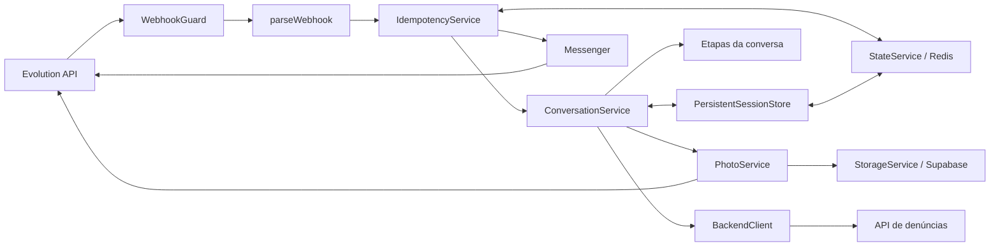

# Arquitetura e fluxo

## Visão geral

O bot usa NestJS e uma máquina de estados determinística. Não há integração com um modelo de IA. A implantação atende uma instância Evolution configurada pelo ambiente.

`AppModule` carrega e valida o ambiente e importa `WebhookModule`. `CommonModule` é global e compartilha a persistência e a coordenação de entregas. `ConversationModule` reúne etapas, sessão, fotos e backend. `MessagingModule` escolhe console na simulação ou Evolution no modo real.

Os arquivos `app.controller.ts` e `app.service.ts` são exemplos legados do scaffold. Não estão registrados no módulo raiz; `GET /` não é um health check implementado.

## Ordem de processamento

1. O guard valida `x-webhook-token` antes de acessar a conversa.
2. O parser valida um evento e cria `IncomingMessage`; eventos fora do contrato retornam `{ ignored: true }`.
3. O coordenador serializa o usuário localmente e, com Redis, adquire um bloqueio compartilhado.
4. Se a mensagem já tem `sent=true`, retorna `{ duplicate: true }`. Se há resposta pendente, reutiliza seu texto.
5. Para uma mensagem inédita, executa a conversa em um contexto de alterações pendentes.
6. Persiste a sessão e a resposta calculada no mesmo lote antes de enviar ao WhatsApp.
7. Envia a resposta e marca a entrega como concluída. Uma falha mantém a resposta pendente e propaga erro HTTP.

O caminho de entrada suportado é o controller. Chamar `ConversationService.handle()` diretamente fornece apenas a fila local do serviço; não acrescenta a deduplicação, a transação e o bloqueio distribuído do webhook.

## Etapas da conversa

| Etapa | Entrada aceita | Próxima etapa |
| --- | --- | --- |
| Sem sessão | Qualquer mensagem abre o menu; `cancelar` cancela sem criar sessão | CATEGORIA |
| CATEGORIA | Número de uma das 11 opções ou nome normalizado da categoria | DESCRICAO |
| DESCRICAO | Texto com pelo menos 10 caracteres após trim | ENDERECO |
| ENDERECO | Texto com pelo menos 5 caracteres após trim | COORDENADAS |
| COORDENADAS | Localização válida ou `pular` | FOTOS |
| FOTOS | Até 5 imagens; `pronto` ou `pular` encerra a etapa | CONFIRMACAO |
| CONFIRMACAO | `sim`, `s`, `confirmo`; `não`/`n` cancela | Envio ou cancelamento |

A primeira mensagem abre o menu e não é reaproveitada como resposta de categoria. `voltar` recua uma etapa e preserva o rascunho; na primeira etapa, apenas informa que não há anterior. `cancelar` encerra em qualquer momento. Em FOTOS, `pular` não remove imagens já recebidas. Em COORDENADAS, `pular` limpa coordenadas anteriores. Categorias devem permanecer alinhadas com a API externa.

`Session` contém `complaintId` (UUID do rascunho), `step` e `draft`. O rascunho guarda textos, coordenadas e `photoUrls`, nunca buffers/base64. Uma interação com sessão existente renova seu TTL. A conclusão só elimina a sessão depois de obter um protocolo válido, dentro da transação do webhook.

## Persistência e concorrência

| Chave Redis | Conteúdo | Expiração |
| --- | --- | --- |
| `chatbot:v1:session:<instância>:<telefone>` | Sessão e rascunho | 30 minutos por gravação |
| `chatbot:v1:delivery:<instância>:<telefone>:<id>` | Texto de resposta e indicador `sent` | 24 horas por gravação |
| `chatbot:v1:lock:user:<instância>:<telefone>` | Token aleatório do dono do bloqueio | 120 segundos, renovados a cada 30 segundos |

A aquisição do bloqueio tenta por até 5 segundos, com intervalos de 100 ms; indisponibilidade gera erro para permitir retry. A liberação e a renovação só ocorrem se o token ainda pertence à execução. A fila local evita concorrência no processo; o Redis coordena réplicas.

`AsyncLocalStorage` isola o lote de alterações por chamada. Leituras dentro de `transaction()` enxergam as próprias escritas pendentes. Uma exceção antes de aplicar o lote descarta essas escritas. O Lua verifica a posse do bloqueio antes de aplicar as operações sem intercalação. Isso **não é rollback ACID** de comandos Redis que falhem durante a execução, nem de uploads/chamadas HTTP já realizados. Transações aninhadas não são suportadas.

O cliente atual usa um servidor Redis único e scripts com múltiplas chaves; não há suporte a Redis Cluster/Sentinel. O modo real não recua para memória quando o Redis falha. A reconexão automática está desabilitada; após recuperar o Redis, reinicie o bot. Persistência e backups do Redis são parte da operação.

Na simulação sem Redis, o armazenamento usa JSON em memória, limpeza periódica a cada minuto e limite de 10.000 entradas entre sessões e respostas. Reiniciar perde esse estado. A limpeza também ocorre nas operações de escrita e na leitura de entradas expiradas.

## Falhas e garantias

| Situação | Comportamento |
| --- | --- |
| Token incorreto | HTTP 401, sem processar a conversa |
| Payload fora do contrato | HTTP 200 com `ignored` |
| Webhook já entregue | HTTP 200 com `duplicate` |
| Falha no cálculo da resposta | Lote pendente descartado; erro HTTP permite retry |
| Falha de envio ao WhatsApp | Resposta permanece pendente; mesmo ID reutiliza o texto |
| Backend retorna 400 | Mantém rascunho e orienta a corrigir dados |
| Backend indisponível ou sem protocolo válido | Mantém rascunho; novo `sim` tenta novamente |
| Falha de upload | Não contabiliza foto; orienta novo envio da imagem |
| Perda de estado Redis | Perde sessões e histórico de deduplicação persistidos nele |

O backend recebe uma chave derivada de `complaintId + JSON.stringify(payload)`. Mesmo rascunho e conteúdo reutilizam a chave; editar o conteúdo muda a chave. O backend deve respeitá-la atomicamente. A deduplicação do webhook tem janela de 24 horas. O provedor WhatsApp pode aceitar um envio e perder a confirmação, causando repetição da resposta. A aplicação não promete entrega exatamente uma vez nem reordena eventos pelo horário original.
